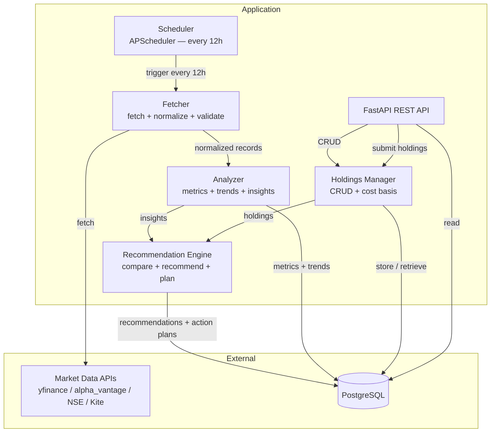
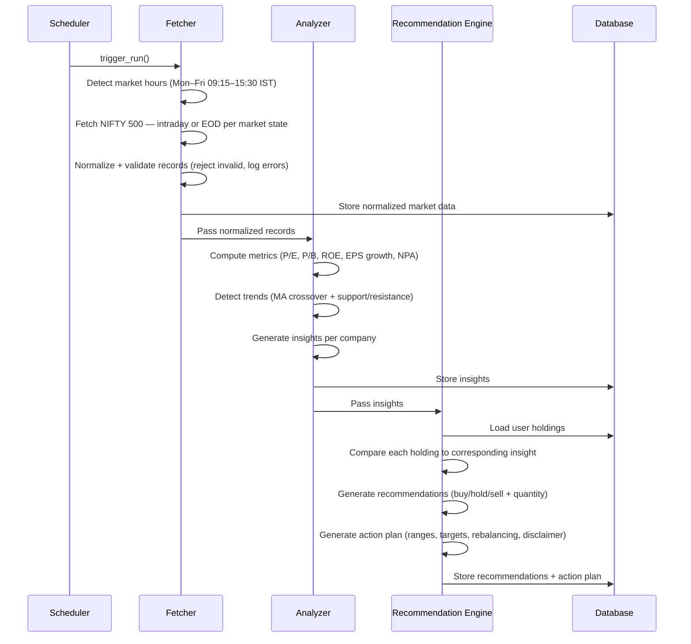
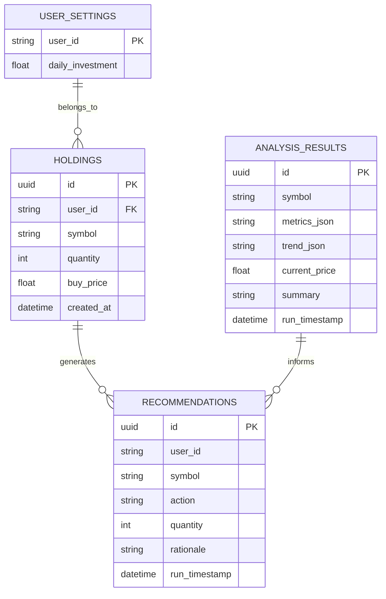

# Design Document: Market Analysis MVP

## Overview

The Market Analysis MVP is a Python-based backend system that fetches NIFTY 500 market data from external APIs, computes financial metrics, detects market trends, integrates user stock holdings, and generates personalized buy/hold/sell recommendations with actionable trading plans. The system exposes REST API endpoints for frontend consumption and runs a scheduled analysis pipeline every 12 hours.

This design covers Phase 1 (MVP) scope: the Data Fetcher, Analysis Engine, Recommendation Engine, and User Holdings Manager, backed by a PostgreSQL database. Notification delivery, subscription tiers, Stripe billing, and the mobile application are out of scope and deferred to Phase 2.

### Technology Stack

| Layer | Technology | Rationale |
|-------|-----------|-----------|
| Language | Python 3.11+ | Matches MVP file structure (`.py` files); rich financial/data ecosystem |
| Web Framework | FastAPI | Async, type-safe, auto-generates OpenAPI docs; used in stock data microservices |
| Database | PostgreSQL + SQLAlchemy 2.0 | Reliable relational store for holdings and analysis results |
| Scheduler | APScheduler | Lightweight in-process scheduler for 12-hour cron-style runs |
| Data Fetching | yfinance, alpha_vantage | Yahoo Finance and Alpha Vantage Python wrappers |
| Analysis | pandas, numpy | Standard libraries for financial metric computation |
| Technical Indicators | pandas-ta | Moving averages, MACD for trend detection |
| Testing | pytest, hypothesis | Unit tests + property-based testing ([Hypothesis](https://hypothesis.works/articles/what-is-hypothesis/)) |

### Research Findings

1. **Property-based testing**: Hypothesis is the de facto PBT library for Python. It generates hundreds of random test inputs from strategies (generators) and shrinks failing cases to minimal counterexamples. It integrates seamlessly with pytest. ([hypothesis.works](https://hypothesis.works/articles/what-is-hypothesis/))

2. **Data sources**: Alpha Vantage provides a free API with a Python wrapper (`alpha_vantage` package) for real-time and historical financial data. yfinance provides Yahoo Finance data. Both support Indian stock symbols. NSE and Zerodha Kite Connect require authentication and are configured as optional providers with fallback. ([alpha_vantage wrapper](https://github.com/RomelTorres/alpha_vantage/blob/develop/README.md))

3. **Trading hours**: NSE (National Stock Exchange of India) equity trading hours are Monday through Friday, 09:15–15:30 IST (UTC+5:30). Market-hours detection must account for the IST timezone and exclude weekends. Public holidays are not modeled in the MVP.

4. **Trend detection**: The MACD (Moving Average Convergence Divergence) indicator and Moving Average Crossover (50/200 SMA) are standard algorithms for classifying bullish/bearish trends. When the short-term MA crosses above the long-term MA, the trend is bullish; below is bearish. ([MA Crossover](https://blog.quantinsti.com/indicators-build-trend-following-strategy/))

5. **Exponential backoff**: The standard backoff sequence for 3 retries starts at 1 second and doubles: 1 s → 2 s → 4 s. This is implemented with `time.sleep(backoff)` where `backoff = 2 ** attempt` (attempt 0, 1, 2).

## Architecture

The system follows a layered architecture with a sequential pipeline at its core. Each layer has a single responsibility and communicates through well-defined interfaces.

### Architecture Diagram



### Pipeline Flow

The core analysis pipeline executes sequentially on each scheduled run:



### Design Decisions

1. **Sequential pipeline over parallel**: The MVP processes 500 companies sequentially through fetch → analyze → recommend. With a 5-minute budget (~0.6 s per company) and in-process execution, this is sufficient. Parallelism can be added in Phase 2 if needed.

2. **Adapter pattern for data sources**: Each external API (yfinance, alpha_vantage, NSE, Kite) gets a dedicated adapter implementing a common `DataSource` interface. The Fetcher cycles through configured adapters with fallback, so adding a new source requires only a new adapter class.

3. **Pure functions for analysis**: Metric computation and trend detection are implemented as pure functions (no side effects, deterministic output for given input). This makes them ideal for property-based testing and keeps the analysis layer testable in isolation.

4. **ORM for persistence**: SQLAlchemy 2.0 provides type-safe database access and migration support via Alembic. Holdings and analysis results are stored as relational tables with foreign key relationships.

5. **IST-aware market hours detection**: `is_market_active()` converts the current UTC time to IST (Asia/Kolkata, UTC+5:30) and checks whether it falls within Monday–Friday 09:15–15:30. Public holidays are not modeled in the MVP.

6. **Validation tightening**: A `NormalizedRecord` is considered valid only when symbol is a non-empty string, price is a strictly positive float, and timestamp is a valid `datetime`. Records failing any check are rejected before reaching the Analyzer.

## Components and Interfaces

### 1. Fetcher (`fetcher.py`)

Responsible for detecting market hours, fetching market data with retry and fallback, normalizing data to a standard format, and validating records.

```python
from zoneinfo import ZoneInfo

IST = ZoneInfo("Asia/Kolkata")
MARKET_OPEN  = time(9, 15)   # 09:15 IST
MARKET_CLOSE = time(15, 30)  # 15:30 IST
MARKET_DAYS  = {0, 1, 2, 3, 4}  # Monday–Friday (weekday() values)


class DataSource(Protocol):
    """Interface for external market data adapters."""

    def fetch_company(self, symbol: str) -> dict:
        """Fetch raw data for a single company."""
        ...

    def is_market_active(self) -> bool:
        """Return True if current time is within NSE trading hours (Mon–Fri 09:15–15:30 IST)."""
        ...


class Fetcher:
    def __init__(self, sources: list[DataSource], max_retries: int = 3):
        ...

    def fetch_nifty500(self) -> list[NormalizedRecord]:
        """Fetch data for all NIFTY 500 companies (intraday if market active, else EOD)."""
        ...

    def fetch_company(self, symbol: str) -> NormalizedRecord | None:
        """Fetch data for a single company with retry + fallback across configured sources.

        Retry schedule: attempt 0 → sleep 1s, attempt 1 → sleep 2s, attempt 2 → sleep 4s.
        On total failure (all retries × all sources), log error with company symbol and return None.
        """
        ...

    @staticmethod
    def normalize(raw_data: dict, api_source: str) -> NormalizedRecord:
        """Normalize API-specific data into a standard NormalizedRecord."""
        ...

    @staticmethod
    def validate(record: NormalizedRecord) -> bool:
        """Return True iff symbol is non-empty string, price > 0, timestamp is valid datetime."""
        ...

    @staticmethod
    def serialize(record: NormalizedRecord) -> str:
        """Serialize record to a JSON string."""
        ...

    @staticmethod
    def deserialize(json_str: str) -> NormalizedRecord:
        """Deserialize a JSON string back to a NormalizedRecord."""
        ...
```

**Market-hours detection (pure function, injectable for testing)**:
```python
def is_market_active(now_utc: datetime | None = None) -> bool:
    """Return True if now_utc (defaults to datetime.utcnow()) falls in NSE trading hours."""
    now_ist = (now_utc or datetime.utcnow()).astimezone(IST)
    if now_ist.weekday() not in MARKET_DAYS:
        return False
    t = now_ist.time()
    return MARKET_OPEN <= t <= MARKET_CLOSE
```

### 2. Analyzer (`analyzer.py`)

Computes financial metrics and detects market trends for NIFTY 500 companies. All metric and trend functions are pure functions.

```python
class Analyzer:
    # --- Metric Computation (pure functions) ---

    @staticmethod
    def compute_pe_ratio(price: float, earnings_per_share: float) -> float | None:
        """P/E = price / EPS. Returns None if EPS <= 0."""
        ...

    @staticmethod
    def compute_pb_ratio(price: float, book_value_per_share: float) -> float | None:
        """P/B = price / book value per share. Returns None if book_value <= 0."""
        ...

    @staticmethod
    def compute_roe(net_income: float, shareholder_equity: float) -> float | None:
        """ROE = net income / shareholder equity. Returns None if equity <= 0."""
        ...

    @staticmethod
    def compute_eps_growth(eps_history: list[float]) -> float | None:
        """EPS growth = (last - first) / first * 100 over trailing 4+ quarters.
        Returns None if list has fewer than 4 elements or first element is zero."""
        ...

    @staticmethod
    def compute_npa(non_performing_assets: float, total_assets: float) -> float | None:
        """NPA = non_performing_assets / total_assets * 100. Banks only.
        Returns None if total_assets <= 0."""
        ...

    # --- Trend Detection (pure functions) ---

    @staticmethod
    def detect_trend(prices: list[float]) -> TrendType:
        """Classify trend as BULLISH, BEARISH, or NEUTRAL using 50/200 SMA crossover.
        Returns NEUTRAL for price sequences too short for the MA window."""
        ...

    @staticmethod
    def compute_support_level(prices: list[float], period: int = 252) -> float | None:
        """Support = min(prices[-period:]). Returns None for empty list."""
        ...

    @staticmethod
    def compute_resistance_level(prices: list[float], period: int = 252) -> float | None:
        """Resistance = max(prices[-period:]). Returns None for empty list."""
        ...

    # --- Insight Generation ---

    def generate_insight(
        self, symbol: str, metrics: CompanyMetrics, trend: Trend
    ) -> Insight:
        """Combine metrics and trend into a company-level Insight."""
        ...
```

### 3. Recommendation Engine (`recommendation.py`)

Compares user holdings against analysis insights and generates personalized recommendations and action plans.

```python
class RecommendationEngine:
    @staticmethod
    def compare_holding_to_insight(
        holding: Holding, insight: Insight, cost_basis: float
    ) -> Comparison:
        """Compare a single holding against its company insight."""
        ...

    @staticmethod
    def generate_recommendation(
        holding: Holding, insight: Insight, cost_basis: float, current_price: float
    ) -> Recommendation:
        """Generate buy/hold/sell recommendation for a holding.

        Rules:
          - BULLISH and current_price < resistance_level  → BUY
          - BEARISH and current_price < cost_basis         → SELL
          - NEUTRAL (or no matching rule)                  → HOLD
        Always attaches the Compliance_Disclaimer.
        """
        ...

    @staticmethod
    def compute_buy_range(
        support_level: float, current_price: float
    ) -> tuple[float, float]:
        """Buy range = (support_level, current_price). Invariant: low <= high."""
        ...

    @staticmethod
    def compute_sell_range(
        current_price: float, resistance_level: float
    ) -> tuple[float, float]:
        """Sell range = (current_price, resistance_level). Invariant: low <= high."""
        ...

    @staticmethod
    def compute_target_price(
        support_level: float, resistance_level: float
    ) -> float:
        """Target price = (support_level + resistance_level) / 2."""
        ...

    @staticmethod
    def compute_suggested_quantity(
        action: ActionType,
        daily_investment: float,
        current_price: float,
        holding_qty: int,
    ) -> int:
        """Suggested quantity = floor(daily_investment / current_price) for BUY,
        holding_qty for SELL, 0 for HOLD. Always non-negative integer."""
        ...

    def generate_action_plan(
        self,
        recommendations: list[Recommendation],
        insights: dict[str, Insight],
    ) -> ActionPlan:
        """Aggregate recommendations into an ActionPlan with ranges, targets,
        rebalancing suggestions, and the Compliance_Disclaimer."""
        ...
```

### 4. Holdings Manager (`user.py`)

Manages user stock holdings: storage, retrieval, validation, and cost basis computation.

```python
class HoldingsManager:
    def __init__(self, session: Session):
        ...

    def add_holding(
        self,
        user_id: str,
        symbol: str,       # non-empty string
        quantity: int,     # positive integer (> 0)
        buy_price: float,  # positive float (> 0)
    ) -> Holding:
        """Validate inputs and store a new Holding in the database.
        Raises ValueError on invalid symbol, non-positive quantity, or non-positive price."""
        ...

    def get_holdings(
        self, user_id: str, symbol: str | None = None
    ) -> list[Holding]:
        """Retrieve holdings for a user, optionally filtered by symbol.
        Returns an empty list if no holdings exist for the given symbol."""
        ...

    def set_daily_investment(self, user_id: str, amount: float) -> None:
        """Set daily investment amount for scalping analysis (must be > 0)."""
        ...

    @staticmethod
    def compute_cost_basis(holdings: list[Holding]) -> float:
        """Weighted average buy price = sum(qty * price) / sum(qty).
        Raises ValueError for empty holdings list."""
        ...

    @staticmethod
    def compute_total_quantity(holdings: list[Holding]) -> int:
        """Total quantity = sum of all holding quantities."""
        ...
```

### 5. API (`api.py`)

FastAPI application exposing REST endpoints with Pydantic request/response schemas.

```python
app = FastAPI(title="Market Analysis MVP")

# --- Pydantic schemas ---

class HoldingRequest(BaseModel):
    user_id: str
    symbol: str          # non-empty
    quantity: int        # > 0
    buy_price: float     # > 0

class HoldingResponse(BaseModel):
    id: str
    user_id: str
    symbol: str
    quantity: int
    buy_price: float
    created_at: datetime

class InsightResponse(BaseModel):
    symbol: str
    pe_ratio: float | None
    pb_ratio: float | None
    roe: float | None
    eps_growth: float | None
    npa: float | None
    trend_type: str
    support_level: float | None
    resistance_level: float | None
    current_price: float
    summary: str
    run_timestamp: datetime

class ActionPlanResponse(BaseModel):
    recommendations: list[RecommendationResponse]
    buy_ranges: dict[str, tuple[float, float]]
    sell_ranges: dict[str, tuple[float, float]]
    target_prices: dict[str, float]
    rebalancing_suggestions: list[str]
    compliance_disclaimer: str

# --- Endpoints ---

@app.post("/holdings", response_model=HoldingResponse, status_code=201)
def submit_holding(holding: HoldingRequest) -> HoldingResponse:
    """Submit a user holding. Returns HTTP 400 on invalid input."""
    ...

@app.get("/analysis", response_model=list[InsightResponse])
def get_analysis(symbol: str | None = None) -> list[InsightResponse]:
    """Retrieve the latest analysis results. Optionally filter by symbol."""
    ...

@app.get("/recommendations", response_model=ActionPlanResponse)
def get_recommendations(user_id: str) -> ActionPlanResponse:
    """Retrieve the latest personalized recommendations and action plan."""
    ...
```

### 6. Scheduler (`scheduler.py`)

Schedules the full analysis pipeline to run every 12 hours.

```python
class AnalysisScheduler:
    def __init__(
        self,
        fetcher: Fetcher,
        analyzer: Analyzer,
        reco: RecommendationEngine,
        db_session_factory: Callable[[], Session],
    ):
        ...

    def start(self) -> None:
        """Configure APScheduler with a 12-hour interval and start the scheduler."""
        ...

    def run_pipeline(self) -> None:
        """Execute the full sequential pipeline: fetch → analyze → recommend → persist."""
        ...
```

## Data Models

### Enumerations

```python
class TrendType(Enum):
    BULLISH = "bullish"
    BEARISH = "bearish"
    NEUTRAL = "neutral"

class ActionType(Enum):
    BUY  = "buy"
    HOLD = "hold"
    SELL = "sell"
```

### Core Data Structures

```python
@dataclass
class NormalizedRecord:
    """Standard normalized market data record from any API."""
    symbol: str           # non-empty string
    price: float          # strictly positive
    timestamp: datetime   # timezone-aware or naive UTC

@dataclass
class CompanyFinancials:
    """Raw financial inputs for metric computation."""
    symbol: str
    earnings_per_share: float
    book_value_per_share: float
    net_income: float
    shareholder_equity: float
    eps_history: list[float]        # Trailing 4+ quarters, oldest first
    is_bank: bool
    non_performing_assets: float | None   # Banks only
    total_assets: float | None            # Banks only

@dataclass
class CompanyMetrics:
    """Computed financial metrics for a company."""
    symbol: str
    pe_ratio: float | None
    pb_ratio: float | None
    roe: float | None
    eps_growth: float | None
    npa: float | None               # Banks only; None for non-banks

@dataclass
class Trend:
    """Trend classification for a company."""
    symbol: str
    trend_type: TrendType
    support_level: float | None     # None if price history is empty
    resistance_level: float | None  # None if price history is empty

@dataclass
class Insight:
    """Company-level analysis summary combining metrics and trend."""
    symbol: str
    metrics: CompanyMetrics
    trend: Trend
    current_price: float
    summary: str

@dataclass
class Holding:
    """A single user position in a stock."""
    id: str                # UUID
    user_id: str
    symbol: str
    quantity: int          # > 0
    buy_price: float       # > 0
    created_at: datetime

@dataclass
class Comparison:
    """Result of comparing a holding to its company insight."""
    holding: Holding
    insight: Insight
    cost_basis: float
    is_profit: bool        # current_price > cost_basis

@dataclass
class Recommendation:
    """Personalized action recommendation for a single holding."""
    symbol: str
    action: ActionType
    quantity: int          # non-negative
    rationale: str
    compliance_disclaimer: str  # Always "Insights only, not financial advice. Educational purpose only."
```

### Action Plan

```python
@dataclass
class ActionPlan:
    """Aggregated actionable summary across all user holdings."""
    recommendations: list[Recommendation]
    buy_ranges: dict[str, tuple[float, float]]    # symbol → (low, high), low <= high
    sell_ranges: dict[str, tuple[float, float]]   # symbol → (low, high), low <= high
    target_prices: dict[str, float]               # symbol → target in [support, resistance]
    rebalancing_suggestions: list[str]
    compliance_disclaimer: str
```

### Database Schema (SQLAlchemy Models)

```python
class HoldingModel(Base):
    __tablename__ = "holdings"
    id: Mapped[str] = mapped_column(primary_key=True)  # UUID
    user_id: Mapped[str] = mapped_column(index=True)
    symbol: Mapped[str] = mapped_column(index=True)
    quantity: Mapped[int]
    buy_price: Mapped[float]
    created_at: Mapped[datetime]

class AnalysisResultModel(Base):
    __tablename__ = "analysis_results"
    id: Mapped[str] = mapped_column(primary_key=True)
    symbol: Mapped[str] = mapped_column(index=True)
    metrics_json: Mapped[str]        # JSON-serialized CompanyMetrics
    trend_json: Mapped[str]          # JSON-serialized Trend
    current_price: Mapped[float]
    summary: Mapped[str]
    run_timestamp: Mapped[datetime] = mapped_column(index=True)

class RecommendationModel(Base):
    __tablename__ = "recommendations"
    id: Mapped[str] = mapped_column(primary_key=True)
    user_id: Mapped[str] = mapped_column(index=True)
    symbol: Mapped[str]
    action: Mapped[str]              # ActionType.value
    quantity: Mapped[int]
    rationale: Mapped[str]
    run_timestamp: Mapped[datetime] = mapped_column(index=True)

class UserSettingsModel(Base):
    __tablename__ = "user_settings"
    user_id: Mapped[str] = mapped_column(primary_key=True)
    daily_investment: Mapped[float]
```

### Entity Relationship Diagram



## Correctness Properties

*A property is a characteristic or behavior that should hold true across all valid executions of a system — essentially, a formal statement about what the system should do. Properties serve as the bridge between human-readable specifications and machine-verifiable correctness guarantees.*

The following properties were derived from the acceptance criteria through prework analysis and property reflection. Redundant properties (1.3 ≡ complement of 1.2; 6.3 ≡ 6.2; 7.2–7.6 consolidated into Property 12) were eliminated. Each property is testable with the [Hypothesis](https://hypothesis.works/articles/what-is-hypothesis/) library for Python.

### Property 1: Market hours detection correctness

*For any* datetime value, `is_market_active()` SHALL return `True` if and only if the corresponding IST local time falls on a weekday (Monday through Friday) and has a time component in the range 09:15–15:30 inclusive.

**Validates: Requirements 1.2, 1.3**

### Property 2: Normalization produces valid records

*For any* raw API response dict containing valid symbol, price, and timestamp values, `normalize()` SHALL produce a `NormalizedRecord` with a non-empty string symbol, a strictly positive float price, and a valid `datetime` timestamp.

**Validates: Requirements 2.1**

### Property 3: Validation correctness

*For any* `NormalizedRecord`, `validate()` SHALL return `True` if and only if the symbol is a non-empty string, the price is strictly positive, and the timestamp is a non-null `datetime`.

**Validates: Requirements 2.2, 2.3**

### Property 4: Normalization serialization round-trip

*For any* valid `NormalizedRecord`, serializing the record to a JSON string and then deserializing it SHALL produce a record with equivalent symbol, price, and timestamp values.

**Validates: Requirements 2.4**

### Property 5: Ratio metric formula correctness

*For any* positive price value and any non-zero positive denominator, each computed ratio (P/E, P/B, ROE) SHALL equal the price divided by the denominator within floating-point tolerance. *For any* denominator value that is zero or negative, each computed ratio SHALL be `None`.

**Validates: Requirements 3.1, 3.2, 3.3**

### Property 6: EPS growth formula correctness

*For any* list of EPS values of length four or greater with a non-zero first element, `compute_eps_growth()` SHALL equal `(last - first) / abs(first) * 100`. *For any* list with a first element of zero or a list shorter than four elements, `compute_eps_growth()` SHALL return `None`.

**Validates: Requirements 3.4**

### Property 7: NPA formula correctness

*For any* bank company with a strictly positive total assets value, `compute_npa()` SHALL equal `(non_performing_assets / total_assets) * 100`. *For any* total assets value that is zero or negative, `compute_npa()` SHALL return `None`.

**Validates: Requirements 3.5**

### Property 8: Trend classification by moving average crossover

*For any* price sequence long enough to compute both MAs, when the short-term MA is strictly greater than the long-term MA the detected trend SHALL be `BULLISH`; when the short-term MA is strictly less than the long-term MA the detected trend SHALL be `BEARISH`; when the two MAs are approximately equal the detected trend SHALL be `NEUTRAL`. For sequences too short for the MA window, the trend SHALL be `NEUTRAL`.

**Validates: Requirements 4.1**

### Property 9: Support and resistance bound all prices in the trailing period

*For any* non-empty price history, `compute_support_level()` SHALL equal the minimum of the trailing 252 prices and `compute_resistance_level()` SHALL equal the maximum of the trailing 252 prices. The support level SHALL be less than or equal to every price in the trailing period and the resistance level SHALL be greater than or equal to every price in the trailing period.

**Validates: Requirements 4.2, 4.3**

### Property 10: Insight contains all metrics and trend fields

*For any* `CompanyMetrics` and `Trend` passed to `generate_insight()`, the returned `Insight` SHALL contain all metric fields (pe_ratio, pb_ratio, roe, eps_growth, npa) and the complete trend classification (trend_type, support_level, resistance_level) with values identical to those in the inputs.

**Validates: Requirements 4.4**

### Property 11: Cost basis equals weighted average buy price

*For any* non-empty list of `Holding` objects for a single company, `compute_cost_basis()` SHALL equal `sum(h.quantity * h.buy_price for h in holdings) / sum(h.quantity for h in holdings)` within floating-point tolerance.

**Validates: Requirements 6.1**

### Property 12: Total quantity equals sum of individual holding quantities

*For any* list of `Holding` objects (including an empty list), `compute_total_quantity()` SHALL equal `sum(h.quantity for h in holdings)`.

**Validates: Requirements 6.2, 6.3**

### Property 13: Holdings retrieval invariant

*For any* user and symbol, after storing N holdings via `add_holding()`, `get_holdings(user_id, symbol)` SHALL return exactly those N holdings. When no holdings exist for the symbol, `get_holdings()` SHALL return an empty list.

**Validates: Requirements 5.1, 5.2, 5.4**

### Property 14: Recommendation action matches trend and price conditions

*For any* `Holding` and corresponding `Insight`, `generate_recommendation()` SHALL produce an `ActionType` of `BUY` when the trend is `BULLISH` and the current price is strictly below the resistance level, `SELL` when the trend is `BEARISH` and the current price is strictly below the cost basis, and `HOLD` when the trend is `NEUTRAL`. The suggested quantity SHALL always be a non-negative integer and the compliance disclaimer SHALL be present in every recommendation.

**Validates: Requirements 7.1, 7.2, 7.3, 7.4, 7.5, 7.6, 12.1**

### Property 15: Action plan ranges and targets are valid

*For any* set of `Recommendation` objects and corresponding `Insight` objects, the generated `ActionPlan` SHALL satisfy: every buy range has `low <= high`, every sell range has `low <= high`, and every target price lies within the closed interval `[support_level, resistance_level]`. The compliance disclaimer SHALL be present in every action plan.

**Validates: Requirements 8.1, 12.2**

## Error Handling

The system handles errors at multiple levels with graceful degradation:

1. **Data Fetching Errors (API failures)**: When a `Market_Data_API` request fails, the Fetcher retries up to 3 times with exponential backoff: 1 s after the first failure, 2 s after the second, 4 s after the third. If all retries fail for a source, the Fetcher logs the error with the affected company symbol and falls back to the next configured source. If all sources are exhausted for a company, the company is logged and skipped, allowing the pipeline to continue with remaining companies.

2. **Data Validation Errors**: Records where symbol is empty, price is non-positive, or timestamp is missing are rejected by `validate()`. When the symbol itself is absent or unparseable, the error is logged with a `"[unknown]"` placeholder. Valid records only proceed to the Analyzer.

3. **Metric Computation Errors**: Division by zero and non-positive denominator conditions (EPS ≤ 0 for P/E, book value ≤ 0 for P/B, equity ≤ 0 for ROE, total assets ≤ 0 for NPA) return `None` rather than raising exceptions. The `Insight` stores `None` for unavailable metrics; downstream components handle `None` gracefully.

4. **Trend Detection Edge Cases**: Price sequences shorter than the short MA window result in `NEUTRAL` trend classification. Empty price sequences return `None` for support and resistance levels.

5. **Holdings Validation Errors**: `add_holding()` raises `ValueError` when symbol is empty, quantity is non-positive, or buy_price is non-positive. The FastAPI layer catches these and returns HTTP 400 with a descriptive message indicating which field failed validation.

6. **Database Errors**: SQLAlchemy sessions are wrapped in transactions with automatic rollback on exception. Connection errors are logged and the scheduler retries on the next 12-hour cycle.

7. **API Input Errors**: FastAPI validates request bodies using Pydantic models with type checking and field constraints. Invalid input returns HTTP 400 with a Pydantic-generated error body indicating the failing field and the constraint violated.

8. **Pipeline Errors**: If the fetch, analyze, or recommend stage fails for a specific company, the error is logged with the stage name and company symbol. The pipeline continues processing remaining companies, ensuring a single company failure does not block the entire run. A failed run does not overwrite previously stored results.

## Testing Strategy

### Dual Testing Approach

The system uses property-based tests for universal correctness and unit/integration tests for specific examples, edge cases, and infrastructure behavior. Both are complementary and necessary for comprehensive coverage.

### Property-Based Tests

Property-based tests validate universal properties using the **Hypothesis** library with **pytest**. Hypothesis generates hundreds of random test inputs from strategies and automatically shrinks failing cases to minimal counterexamples.

**Configuration**:
- Minimum 100 iterations per property test: `@settings(max_examples=100)`
- Each test references its design document property via a comment tag
- Tag format: `# Feature: market-analysis-mvp, Property N: <property title>`

**Test files**:

| File | Properties Covered |
|------|--------------------|
| `tests/properties/test_market_hours.py` | Property 1 |
| `tests/properties/test_normalization.py` | Properties 2, 3, 4 |
| `tests/properties/test_metrics.py` | Properties 5, 6, 7 |
| `tests/properties/test_trends.py` | Properties 8, 9 |
| `tests/properties/test_insights.py` | Property 10 |
| `tests/properties/test_holdings.py` | Properties 11, 12, 13 |
| `tests/properties/test_recommendations.py` | Properties 14, 15 |

Example property test:

```python
from hypothesis import given, settings
from hypothesis import strategies as st
from src.fetcher import Fetcher, NormalizedRecord
from datetime import datetime

# Feature: market-analysis-mvp, Property 4: Normalization serialization round-trip
@given(
    st.text(min_size=1),
    st.floats(min_value=0.01, allow_nan=False, allow_infinity=False),
    st.datetimes(),
)
@settings(max_examples=100)
def test_normalization_round_trip(symbol: str, price: float, timestamp: datetime) -> None:
    record = NormalizedRecord(symbol=symbol, price=price, timestamp=timestamp)
    restored = Fetcher.deserialize(Fetcher.serialize(record))
    assert restored.symbol == record.symbol
    assert restored.price == record.price
    assert restored.timestamp == record.timestamp
```

### Unit Tests

Unit tests cover specific examples and edge cases not suited for property-based testing:

- **Retry behavior**: mock data source failing 0, 1, 2, and 3 times; verify attempt count and backoff delays (1 s, 2 s, 4 s)
- **Fallback behavior**: mock sources where the first always fails and the second succeeds; verify the second source is used
- **Missing-symbol logging**: submit a record with no symbol; verify error is logged with `"[unknown]"` placeholder
- **Compliance disclaimer**: verify the disclaimer string `"Insights only, not financial advice. Educational purpose only."` is present in every `Recommendation` and `ActionPlan`
- **Holdings validation boundaries**: submit a holding with quantity 0, negative quantity, price 0, empty symbol; verify `ValueError` is raised for each

### Integration Tests

Integration tests verify component wiring, database operations, and API behavior:

- **FastAPI TestClient**:
  - `POST /holdings` with valid and invalid payloads — verify HTTP 201 and HTTP 400
  - `GET /analysis` — verify HTTP 200 and response schema matches `InsightResponse`
  - `GET /recommendations` — verify HTTP 200 and `ActionPlanResponse` schema
- **SQLAlchemy test database** (SQLite in-memory or PostgreSQL test schema):
  - Add holdings, retrieve by user_id and symbol, verify persistence across sessions
  - Verify analysis results are stored with run_timestamp
- **Pipeline execution**: mock external APIs, run `AnalysisScheduler.run_pipeline()`, verify fetch → analyze → recommend executes in sequence and results are stored
- **Performance test**: run the full pipeline for 500 companies with mocked data sources; verify completion within 5 minutes

### Test Strategy by Requirement

| Requirement | Test Type | Details |
|-------------|-----------|---------|
| 1. Fetch NIFTY 500 Data | Integration + Example | Mocked APIs, retry backoff (1s/2s/4s) verification, fallback verification |
| 2. Normalize & Validate | Property | Properties 2, 3, 4 |
| 3. Compute Metrics | Property | Properties 5, 6, 7 |
| 4. Detect Trends | Property | Properties 8, 9, 10 |
| 5. Manage Holdings | Property + Example | Property 13, boundary validation examples |
| 6. Compute Cost Basis | Property | Properties 11, 12 |
| 7. Generate Recommendations | Property | Property 14 |
| 8. Generate Action Plans | Property + Example | Property 15, rebalancing example, disclaimer example |
| 9. Expose REST API | Integration | FastAPI TestClient all endpoints |
| 10. Persist Data | Integration | Test database CRUD + run_timestamp verification |
| 11. Schedule Analysis | Smoke + Integration | APScheduler config check, mocked pipeline run |
| 12. Compliance Disclaimer | Example | Disclaimer string in Recommendation and ActionPlan |
| 13. Analysis Performance | Integration | Timed 500-company run with mocked sources |

### Why PBT Applies to This Feature

The core analysis and recommendation logic consists of pure functions with clear input/output behavior:

- **Metrics computation** (P/E, P/B, ROE, EPS growth, NPA) are mathematical formulas — universal correctness is verifiable across all valid numeric inputs
- **Market-hours detection** is a pure function of datetime — the correctness rule can be verified for any generated datetime value
- **Data normalization and serialization** involve parsing/formatting — round-trip properties catch parser/serializer bugs that example tests miss
- **Cost basis and quantity computation** are invariant-preserving operations — the weighted average and sum invariants hold for all input sets
- **Trend detection and recommendation logic** follow deterministic rules — the MA crossover and action-mapping rules can be verified against generated price sequences and insight combinations

External API calls, database operations, and scheduling are tested with integration and smoke tests rather than PBT, as their behavior does not vary meaningfully with randomized input and running 100+ iterations would be expensive.
